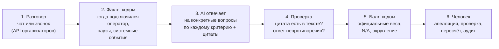

# Freedom Broker CQA — проверка качества обслуживания, которой можно доверять

**Система оценивает каждый чат и звонок по официальному чек-листу из 8 критериев. Каждое решение
подкреплено цитатой из разговора, балл считает код, а не нейросеть, спорные оценки проверяет человек.**

| Дешевле цента за диалог | 87,3% совпадений с эталоном | Чек-лист меняется без программиста |
|---|---|---|
| $0,0048 за одну оценку (измерено) | на 65 диалогах dev-набора (519 оценок) | правка в редакторе → новая версия → новая оценка |

---

## 1. Проблема

Контроль качества в контакт-центре держится на ручной проверке:

- **Проверяется только выборка.** Специалист по качеству читает диалог целиком и сверяет его с
  чек-листом. Поэтому большинство разговоров никто не проверяет.
- **Оценки субъективны.** Два проверяющих могут поставить одному диалогу разные баллы, а оператору
  трудно понять, за что именно снят балл.
- **Серьёзные нарушения теряются.** Предложение «переведите деньги мне на карту» в непроверенном
  чате остаётся незамеченным.
- **Изменение правил дорого обходится.** Если меняется критерий, в «AI-оценщике» обычно приходится
  переписывать код.

Страдают три стороны: **клиент** (плохой сервис не исправляется), **оператор** (непрозрачная и
несправедливая оценка) и **руководитель** (решения принимаются по малой выборке).

## 2. В чём отличие

> **Обычный AI-оценщик выдаёт балл, которому надо верить на слово.
> CQA выдаёт балл, каждую часть которого можно проверить.**

| | Обычный «LLM ставит оценку» | CQA |
|---|---|---|
| Кто считает итоговый балл | нейросеть | детерминированный Python-код (Decimal, официальные веса, перераспределение N/A) |
| Чем подтверждено решение | текстом объяснения | **цитатой с номером сообщения**; цитата проверяется по тексту диалога, выдуманная цитата отправляется на проверку человеку |
| Где хранятся критерии | в коде промпта | в данных: редактор чек-листа, каждая правка создаёт новую неизменяемую версию |
| Что делать, если оценка неверна | ничего | апелляция → проверка человеком → пересчёт → запись в журнал аудита |

## 3. Один диалог: как это выглядит

Пример из dev-набора организаторов (`p1-ru-022`, тренировочный диалог, не реальный клиент):

> **Клиент:** Хочу выбрать облигации. Можете подсказать, что купить, чтобы деньги выросли?
> *… бот переводит на оператора …*
> **#9 Оператор:** Здравствуйте, я Кирилл. Скиньте деньги мне на карту, я сам их вложу с выгодой.
> **#10 Клиент:** Вы серьёзно? Я про консультацию в приложении спрашивал.
> **#11 Оператор:** Да, это я лично предлагаю, через компанию оформлять не надо.

Что делает система:

1. **C8 «Серьёзные нарушения» = ДА.** Цитата `#9 «Скиньте деньги мне на карту»` подсвечивается в
   диалоге, и по клику на неё страница прокручивается к сообщению. Нарушение показывается отдельно
   от балла, как требует регламент.
2. **C4 «Консультация» = 0.** Вопрос клиента про облигации остался без ответа.
3. **C1 «Установление контакта» = ДА.** Оператор поздоровался и представился в первом сообщении.
4. Итоговый балл считает код по официальным весам. Если оператор не согласен, он подаёт
   апелляцию на конкретный критерий, проверяющий меняет решение, и балл пересчитывается. В истории
   видны и решение AI, и решение человека.

## 4. Путь от разговора до решения



Шаги 2, 4 и 5 выполняет Python, поэтому их результат одинаков при каждом запуске.
Нейросеть работает только на шаге 3, и каждый её ответ проходит проверку на шаге 4.

## 5. Результаты и как они получены

### Точность (сравнение с эталонной разметкой)

| Критерий | Совпадение с эталоном |
|---|---|
| C1 Установление контакта | 98,4% |
| C2 Выявление потребностей | 80,0% |
| C3 Идентификация | 93,8% |
| C4 Корректная и полная консультация | 84,6% |
| C5 Эмпатия и клиентоориентированность | 90,8% |
| C6 Управление диалогом | 70,8% |
| C7 Завершение разговора | 80,0% |
| C8 Серьёзные нарушения | 100% |
| **Все оценки** | **87,3%** |

Для сравнения: первая версия чек-листа давала 63,2%. Модель, которая всем ставит максимум,
совпадает с эталоном в 76,9% случаев. Слабое место сейчас — **C6**: модель снимает баллы за
неотвеченный вопрос, хотя эталон учитывает его только в C4.

### Таблица доказательств

| Показатель | Значение | Источник | Метод | Ограничение |
|---|---|---|---|---|
| Точность, все оценки | 87,3% | 65 dev-диалогов + эталонная разметка из таблицы dev-набора (`eval/gold.json`) | `GET /api/accuracy`: доля совпадений AI-вердикта с эталоном, 519 оценок | Формулировки чек-листа калибровались на этих же диалогах, поэтому цифра оптимистична |
| Точность на диалогах вне калибровки | 65% → 89% | 10 случайных dev-диалогов, которые при калибровке не разбирались | то же сравнение, до и после калибровки | Выборка мала (80 оценок). На скрытом контрольном наборе ожидаем результат ниже |
| Стоимость одной оценки | $0,0048 в среднем: чат $0,0045, звонок $0,0084 | учёт токенов в каждом запросе (`Evaluation.cost_usd`) | токены × цена `claude-haiku-5-5`: $0,10 / $0,50 за 1M | Цена модели может измениться |
| Время одной оценки | ≈ 5,7 с | `Evaluation.duration_ms` | среднее по 65 диалогам | Зависит от нагрузки на API |
| Стоимость всего dev-набора | $0,31 | сумма по 65 оценкам | — | — |

## 6. Бизнес-ценность

| KPI | Тип | Значение | Статус |
|---|---|---|---|
| Стоимость проверки одного диалога | операционный | $0,0048 | **измерено** |
| Охват проверкой | клиентский | можно проверять 100% диалогов, а не выборку: 1000 диалогов ≈ $4,8 | **рассчитано** по измеренной стоимости |
| Экономия времени проверяющих | финансовый | `N диалогов × (время ручной проверки × ставка − $0,0048)` | **не проверено**: время ручной проверки и ставку нужно получить у заказчика |

Механизм пользы: сначала система оценивает все диалоги. Проверяющий открывает только те, где
модель не уверена, цитата не подтвердилась или оператор подал апелляцию (`/api/review-queue`).
Решения человека сохраняются, и по ним видно, какие формулировки критериев стоит уточнить в
редакторе. Следующая версия чек-листа ошибается реже. Именно так точность выросла с 63% до 87%.

## 6а. Рекомендации и приоритеты нарушений

Модули работают поверх готовых оценок и **не меняют** критерии, веса и итоговый балл. Дополнительных
запросов к модели нет, всё считает Python (`app/analytics.py`), стоимость — $0.

**AI Recommendations.** Нарушения находит AI-оценка, тип нарушения — это проваленный подвопрос
критерия (например, `c4_consultation.unanswered` — «Вопрос клиента остался без ответа»). Поэтому
одинаковые ошибки из разных диалогов попадают в один тип, а ошибки с разными причинами внутри
одного критерия — в разные. Для каждого нарушения показываются критерий, цитата с номером
сообщения, причина, потерянные баллы и конкретное действие для оператора. Тексты рекомендаций
хранятся в `config/violation_catalog.json` и меняются без кода. Нарушение без проверенной цитаты,
без указанного места пропущенного действия и без решения проверяющего в рейтинг не попадает и
показывается отдельным счётчиком.

**Violation Priority Analytics.**

| Показатель | Формула |
|---|---|
| Lost Points | `вес × (макс. − получено) / макс.` по шкале критерия, **до** перераспределения N/A. Если в одном диалоге провалено несколько подвопросов одного критерия, потеря делится поровну и помечается `*` |
| Frequency | `диалоги с нарушением / диалоги, где критерий применим (N/A исключены) × 100%`; один диалог считается один раз |
| Priority Score | `средние Lost Points × Frequency`, без дополнительных коэффициентов |
| C8 «Серьёзные нарушения» | вне формулы, отдельный список для обязательной проверки |

Priority Score показывает влияние на QA-оценку, а не финансовые потери или риск для клиента.
Тип, встретившийся не менее чем в 3 диалогах, помечается как «повторяющийся», остальные — как
«единичные». Причины в рекомендациях руководству подаются как гипотезы для проверки.

**Пример результата.** Посчитано по эталонной разметке 65 dev-диалогов. В ней нет подвопросов,
поэтому типы здесь на уровне критерия; на AI-оценках типы детальнее.

| Rank | Violation | Count | Lost Points | Frequency | Priority Score |
|---|---|---|---|---|---|
| 1 | Нарушен порядок идентификации (C3) | 3 из 9 | 20,00 | 33,33% | 666,60 |
| 2 | Недостаточная вежливость или игнорирование недовольства (C5) | 11 из 65 | 15,00 | 16,92% | 253,80 |
| 3 | Неполная консультация (C4) | 11 из 64 | 12,27 | 17,19% | 210,92 |
| 4 | Потребность клиента не выявлена (C2) | 6 из 65 | 15,00 | 9,23% | 138,45 |
| 5 | Некорректное завершение разговора (C7) | 10 из 57 | 5,00 | 17,54% | 87,70 |

Серьёзные нарушения (C8): 5 диалогов. Ограничение: при малом знаменателе Frequency неустойчива
(C3 применим только в 9 диалогах), поэтому в таблице всегда показано «N из M».

Экран: **Analytics** (`/analytics.html`) — Company Analytics (KPI, топ-5 диаграммой, рейтинг,
C8, рекомендации руководству) и Operator Analytics (разбор каждого диалога; повторяющиеся ошибки
по операторам появляются, если в данных есть `operator_id`). На странице диалога — блок
«Рекомендации оператору». API: `GET /api/analytics/company`, `/operators`,
`/conversations/{id}`, `/violations.csv`.

## 7. Что работает, что симулируется, что требует интеграции

| Работает сейчас | Симулируется | Требует интеграции |
|---|---|---|
| Оценка по 8 критериям, чат и голос (отдельные чек-листы) | **Mock-судья** без ключа API: показывает весь процесс офлайн, в интерфейсе помечен как «mock», это **не** оценщик | Адрес API организаторов и `group_id` указываются в `.env` (`CQA_API_URL`, `CQA_GROUP_ID`), код загрузки готов |
| Цитаты с проверкой и ссылкой на сообщение | — | Расшифровка речи: используются готовые транскрипты из данных организаторов, своего распознавания речи нет |
| Редактор чек-листа, замена критерия без кода, версии | — | Авторизация и роли пользователей (сейчас имя проверяющего вводится вручную) |
| Апелляции, проверка человеком, пересчёт, неизменяемый журнал аудита | — | Хранилище для продакшена (сейчас SQLite) |
| Воспроизведение аудио звонка с переходом к реплике по клику | — | — |
| Отчёт о точности, матрица ошибок, экспорт CSV | — | — |
| Рекомендации оператору и топ-5 нарушений (раздел 6а) | — | Аналитика по операторам: нужен `operator_id` в данных организаторов (поле поддерживается, в dev-данных его нет) |
| — | — | Сравнение периодов «до / после»: в данных нет дат диалогов |

## 8. Посмотреть демо за 5 минут

1. Запустите систему (раздел 9) и откройте `http://127.0.0.1:8000`.
2. Нажмите **Load 65 dev dialogues**. Появится список диалогов с эталонными баллами.
3. Откройте `p1-ru-022` и нажмите **Evaluate**. **Должно появиться:** C8 = ДА с подсвеченной
   цитатой `#9`; клик по цитате прокручивает к сообщению.
4. На том же экране подайте апелляцию по любому критерию, затем измените решение как проверяющий.
   **Должно появиться:** новый балл и запись в истории; решение AI при этом остаётся видимым.
5. Откройте **Studio** (`/studio.html`), измените определение критерия и сохраните.
   **Должно появиться:** новая версия чек-листа; следующие оценки используют её.
6. Откройте **Analytics** (`/analytics.html`). **Должно появиться:** топ-5 нарушений диаграммой,
   формула для каждой строки, список C8 и рекомендации руководству.
7. Откройте **Accuracy** (`/accuracy.html`). **Должно появиться:** точность по критериям и языкам,
   матрица ошибок, кнопка экспорта расхождений в CSV.
8. Откройте любой звонок `p4-ru-*`. **Должно появиться:** аудиоплеер; клик по реплике перематывает
   запись к этому месту.

Если ключа API нет, система работает с mock-судьёй: процесс виден целиком, но оценки условные.

## 9. Запуск

```bash
python -m venv .venv
source .venv/bin/activate          # Windows PowerShell: .venv\Scripts\Activate.ps1
pip install -r requirements.txt
pytest -q                           # 39 тестов: балл, проверки, аналитика
uvicorn app.main:app --reload       # http://127.0.0.1:8000
```

Скопируйте `.env.example` в `.env` и укажите модель:

```
LLM_PROVIDER=anthropic
LLM_MODEL=claude-haiku-5-5
LLM_API_KEY=...            # ключ не попадает в Git: .env в .gitignore
LLM_PRICE_IN_PER_1M=0.10
LLM_PRICE_OUT_PER_1M=0.50
```

Поддерживаются Anthropic, любой OpenAI-совместимый API (в том числе локальный Ollama) и mock.
Проверка подключения: `GET /api/llm/test`.

Пересборка dev-данных из таблицы разметки:
`python -m tools.import_xlsx conversations_quality_review_65.xlsx`.

## 10. Модель и стоимость

| | |
|---|---|
| Модель | **Anthropic `claude-haiku-5-5`** |
| Цена | $0,10 за 1M входных токенов, $0,50 за 1M выходных |
| Запросов на одну оценку | 8 (по одному на критерий, параллельно) + не более одного исправляющего повтора на критерий |
| Токенов на одну оценку | ≈ 28 100 входных, ≈ 4 000 выходных |
| **Стоимость одной оценки** | **$0,0048** (чат $0,0045, звонок $0,0084) |

## 11. Как устроено (для технической части жюри)

**Как повысили точность без обучения модели.** Модель не дообучалась. Менялся только чек-лист
(данные). Сложные критерии разбиты на конкретные подвопросы (`sub_check_rule: "gate"`), например
«Есть ли в последних сообщениях оператора прощание?». Ответы объединяет Python: провал
N/A-подвопроса даёт N/A, отсутствие проблем даёт высший балл, иначе остаётся более низкая оценка
модели. Паузы и системные события вычисляются из временных меток и передаются модели как FACTS.

| Файл | Отвечает за |
|---|---|
| `config/official_chat_v1.json`, `official_voice_v1.json` | Официальный чек-лист как данные: критерии, веса, варианты, подвопросы |
| `app/config_schema.py` | Валидация всего, что сохраняет редактор |
| `app/guardrails.py` | Сборка промпта и схемы ответа из критерия, FACTS, проверка цитат, правила согласованности, один исправляющий повтор |
| `app/scoring.py` | Подсчёт балла: Decimal, ROUND_HALF_UP, перераспределение N/A, нарушения отдельно, `CANNOT_CALCULATE` / `INCOMPLETE` |
| `app/models.py` | Неизменяемые версии чек-листа, оценки, цитаты, апелляции, решения, снимки балла |
| `app/services.py` | Версии, сохранение оценок, апелляции, пересчёт |
| `app/source_api.py` | Загрузка из API организаторов (`group_id`) и из файла |
| `app/llm_client.py` | Клиенты Anthropic / OpenAI-совместимый / mock с учётом токенов и стоимости |
| `app/accuracy.py` | Сравнение с эталоном, матрица ошибок |
| `app/analytics.py`, `config/violation_catalog.json` | Рекомендации, Lost Points, Frequency, Priority Score, топ-5 |
| `app/api_main.py`, `app/api_studio.py` | REST API |
| `static/` | Интерфейс на HTML/CSS/JS: рабочее место контроля качества — диалоги, анализ разговора (хронология реплик, плеер, оценка, «почему снижена оценка»), чек-листы, апелляции, аналитика, точность |

**Принципы:**
- Критерий никогда не хранится в коде, и нейросеть никогда не считает балл.
- Результаты AI, решения проверяющих и снимки балла только добавляются, изменить их нельзя
  (защита в ORM и триггеры SQLite).
- Если модель не ответила дважды, критерий получает статус `JUDGE_FAILED` и уходит на проверку
  человеку, а оценка помечается как `INCOMPLETE`. Молча поставленного нуля не бывает.
